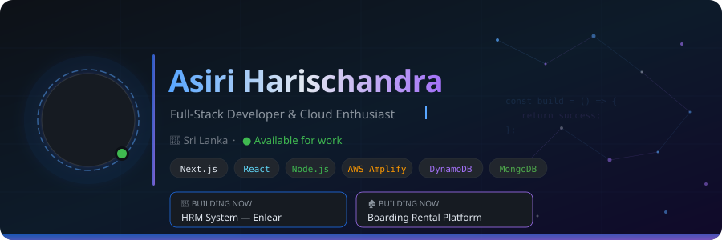

<div align="center">



<p>
  
  &nbsp;
  
  &nbsp;
  
</p>

</div>

---

## About Me

```ts
const asiri = {
  name:     "Asiri Harischandra",
  location: "Sri Lanka 🇱🇰",
  role:     "Full-Stack Developer",
  education: "BSc (Hons) IT — University of Moratuwa (2024–present)",
  focus:    ["Next.js", "React", "MERN", "AWS Amplify Gen 2"],
  currentlyBuilding: [
    "HRM System for Enlear",
    "Boarding Rental Web Platform",
    "LearnSphere — E-learning Platform",
  ],
  learning: ["System Design", "Cloud-Native Patterns", "Spring Boot"],
};
```

---

## 🛠️ Tech Stack

**Languages**


**Frontend**


**Backend & Cloud**


**Databases**


<details>
<summary>🔧 Tools & Extras</summary>
<br/>


</details>

---

## 📌 Featured Repositories

<!-- Each card pulls the repo's real description, language and stars automatically -->
<div align="center">

<a href="https://github.com/AsiriHarischandra/bodim_fee"></a>
<a href="https://github.com/AsiriHarischandra/AS-hotel"></a>
<a href="https://github.com/AsiriHarischandra/popguard"></a>
<a href="https://github.com/AsiriHarischandra/TO-Do-mern"></a>

</div>

---

## 🚧 In Progress (private / not yet public)

| Project | What it does | Stack |
|---|---|---|
| **HRM System — Enlear** | Employee management, payroll, attendance & leave, analytics | `Next.js` · `Amplify Gen 2` · `DynamoDB` |
| **Boarding Rental Platform** | Search & filter boardings, photo listings, maps, booking, payments | `Next.js` · `Node.js` · `MongoDB` |
| **LearnSphere — E-Learning** | Gamified courses, XP & streaks, student/tutor leaderboards, live classes | `Next.js` · `Spring Boot` · `MongoDB` · `React Native` |

---

## 📊 GitHub Stats

<div align="center">


&nbsp;


</div>

---

## 📈 Contribution Graph

<div align="center">


</div>

---

## 🤝 Connect With Me

<div align="center">

[](https://www.linkedin.com/in/asiri-harischandra-2209b3305/)
[](https://asiri-portfolio-v2.vercel.app)
[](mailto:asiriharischandra33@gmail.com)
[](https://dev.to/asiriharischandra)
[](https://www.facebook.com/asiri.harischandra)

</div>

<div align="center">
  <sub>Built with ❤️ by Asiri Harischandra · Sri Lanka 🇱🇰</sub>
</div>
